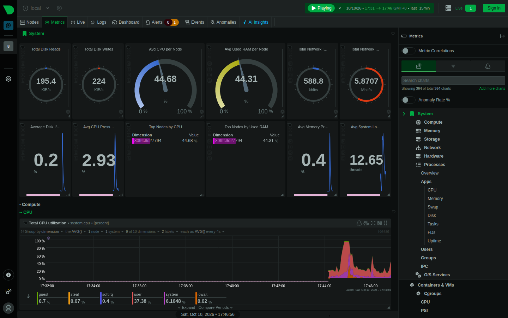
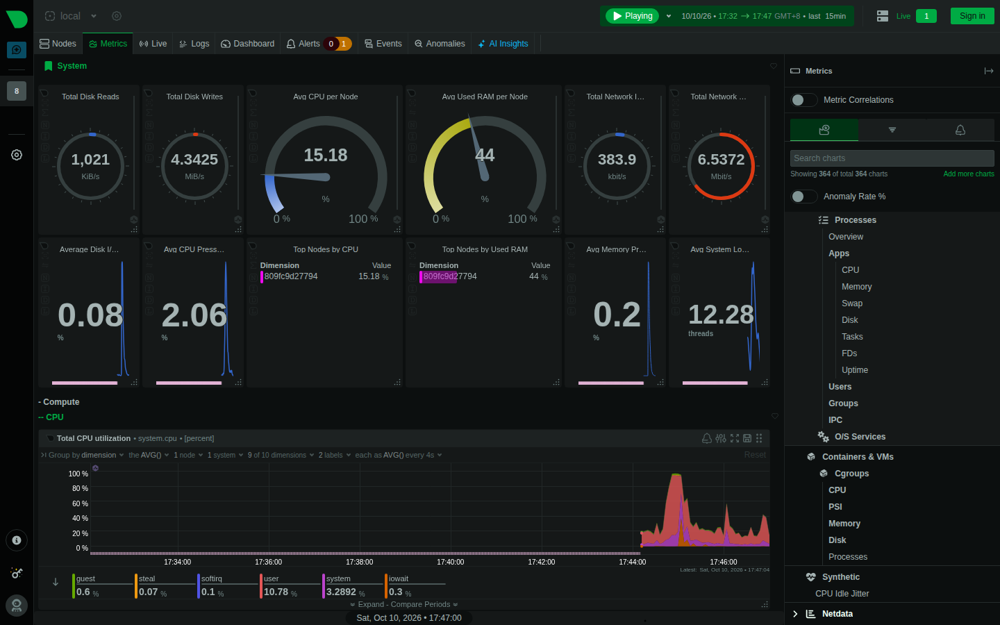
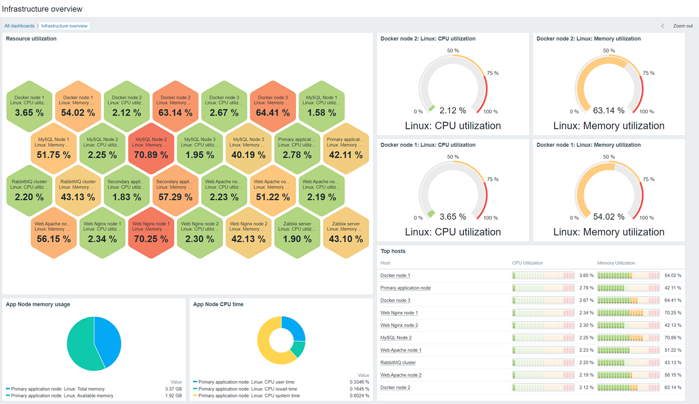
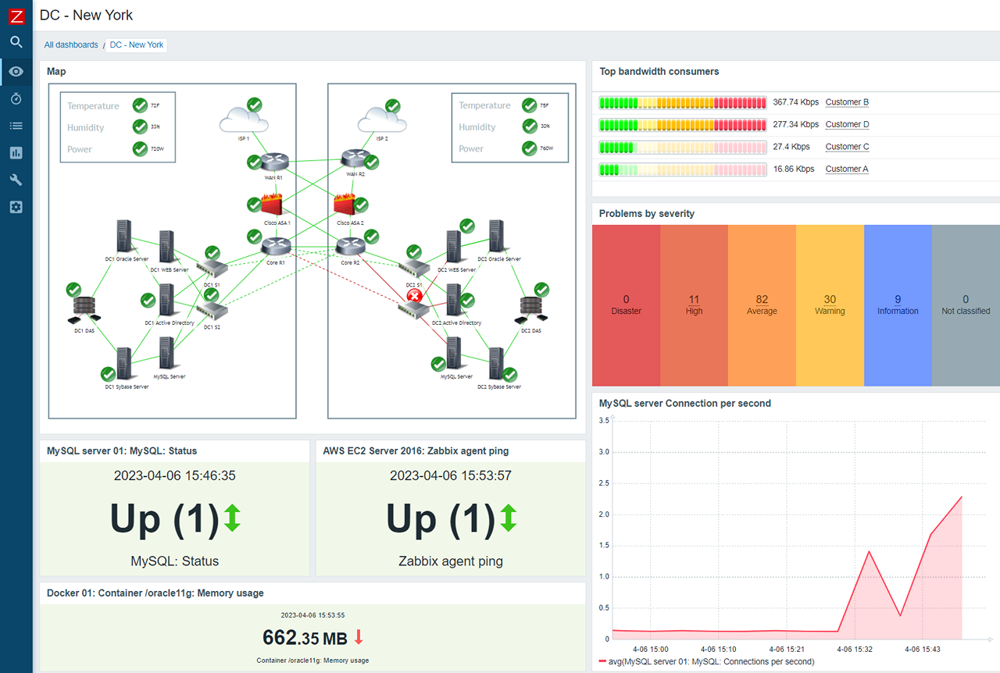
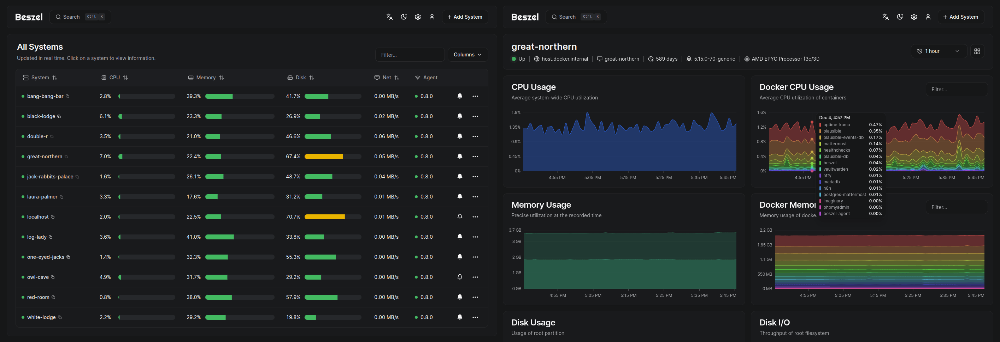
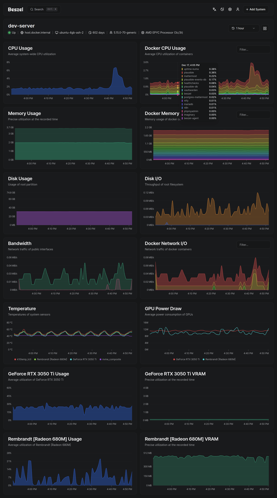
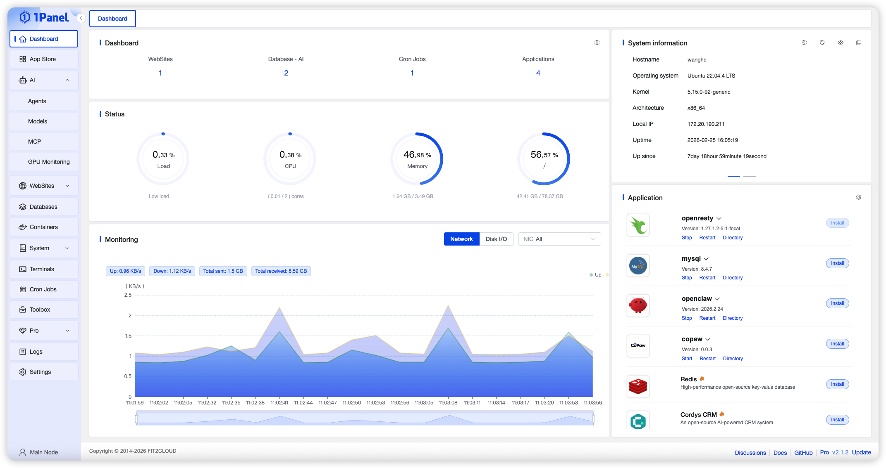
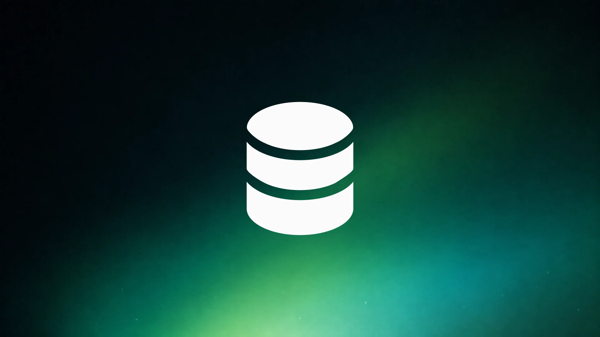
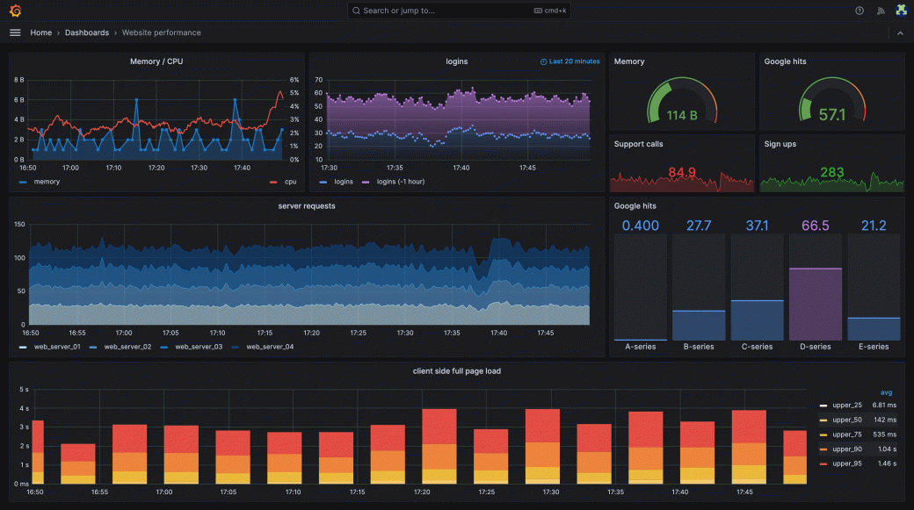

# Ops Open-Source Solution Survey (Monitoring Panels / Liveness Collection)

This document records the comparison conclusions for six comparable open-source solutions, following the survey four-piece format (embedded screenshots + sources + referenceable analysis + navigation link). It answers one suspended question: **should Cockpit's liveness collection be developed in-house, or connected to an off-the-shelf data source (a Prometheus / Netdata provider)?**.

Survey date: 2026-10-10. Screenshots are mainly real UI images from official sites/docs/READMEs; the two Netdata ones are real captures from a local container. For the qualitative comparison see [Reference project comparison and takeaways](/guide/reference-projects) (2026-09, covering Komodo/Portainer/Guacamole/Teleport/NetBox/Uptime Kuma) — this document does not repeat those conclusions, it adds six monitoring panels plus the collection-route verdict.

## Overview

| Solution | Positioning | Architecture | One-line conclusion for Cockpit |
| --- | --- | --- | --- |
| Netdata | per-second full single-host metrics + built-in alerting | agent (C/Go) + optional cloud plane | Borrow the "zero-config, works out of the box" idea; don't adopt its agent as the collection base |
| Zabbix | enterprise fleet monitoring (templates/SNMP/topology maps) | server + proxy + DB (PHP/Java) | Not applicable wholesale (too heavy); templating and multi-point topology are worth comparing |
| Beszel | lightweight homelab monitoring | hub + agent (Go, isomorphic to Cockpit) | Referenceable (already benchmarked in a prior survey); the agent resource baseline remains a hard metric |
| 1Panel | single-host Linux server management panel | installed directly on the host (Go + Vue, no agent) | Borrow the information architecture (settings page grouping, app store templates) |
| Coolify | self-hosted PaaS (git→build→deploy) | Docker/SSH orchestration (single or multi host) | Borrow the deployment pipeline interaction; don't adopt wholesale (different positioning from a control plane) |
| Prometheus + Grafana | metrics de-facto standard + visualization | pull collection + TSDB + separate presentation layer | Use as an integration standard; align metrics to its format, keep liveness in-house |

## ① Netdata (agent / per-second metrics / alerting)

An open-source agent (GPLv3, C/Go). Installed on a single host it automatically discovers services and starts collecting every second with no configuration; the health plane has built-in alert expressions and notifications; since v2 the web dashboard ships with anomaly detection (ML) and an AI interpretation entry; the cloud plane (netdata.cloud) can be turned off, with anonymous access to the local dashboard.

Source: real capture from a local Docker container (`netdata/netdata`, 127.0.0.1:19999, v2.12.0-nightly) via Playwright, 2026-10-10. A real capture of a single-container node already produced 6092 metrics and 364 charts automatically.

**Referenceable**

- First-screen experience: there is an answer the moment you open it — a gauge first screen (CPU/RAM/disk/network) + node table + chart navigation. Cockpit's web overview page can be organised around "one screen that reads the whole infrastructure".
- Auto-discovery: once the agent is up it knows what is running on the machine and builds charts automatically. Cockpit agent's service discovery / drift plane can benchmark against this "data appears without filling in config" default design.

**Worth adopting**

- Collection/retention tiering (dbengine multi-tier: per-second near-line + downsampled far-line): if Cockpit's metrics plane later lands on SQLite storage, the downsampling tiers should directly follow this model.
- Alerting embedded in the collection layer (expressions + consecutive-window failure judgement) is isomorphic to the croupier probe agent's threshold/recovery debounce, validating that "window-based stability judgement" is a general convention.

**Not applicable (as a collection base)**

- Why: the cost of per-second full collection is hundreds of MB of resident memory; the cloud plane is closed source, and anonymous mode pushes a sign-in gate on every dashboard visit (the real capture this time required manually skipping it); replacing every machine in a "personal hybrid infrastructure" with a netdata agent amounts to outsourcing Cockpit's collection plane to a third party that brings its own control plane.
- Landing point: don't adopt; only keep the "connect to its Prometheus endpoint" path (see the verdict at the end).

## ② Zabbix (fleet monitoring / templates / SNMP)

One of the de-facto enterprise monitoring standards: server + proxy + an independent DB, a template library standardising monitoring items, multi-protocol collection over SNMP/IPMI/agent, and visualization including dashboards and network topology maps.

Source: [zabbix.com/product](https://www.zabbix.com/product) official product page (assets.zabbix.com), downloaded 2026-10-10.

**Referenceable**

- Multi-point topology (layered collection via proxies, aggregated display via topology maps): the capability croupier's suspended "multi-point placement, to be discussed separately" is exactly this; Zabbix's proxy tree + map is the most complete industry reference — three separated layers of point agents collecting, an aggregation layer merging, and topology map presentation.
- What SNMP / agentless collection means for "hybrid infrastructure": devices that can't host an agent — switches, routers, NAS — only have SNMP/ICMP available, and Cockpit's future OpenWrt/NAS line cannot avoid this.

**Worth adopting**

- Templating of monitoring items: one template per device class (standard item + trigger), and attaching a template to a host gives you monitoring. Cockpit's service detection probe.yaml target format can grow a "template/preset" layer to avoid hand-writing targets on every machine.

**Not applicable (adopting wholesale)**

- Why: a PHP/Java server plus an independent DB is a heavyweight architecture whose runtime cost and operations surface far exceed the scale of personal infrastructure; its configuration surface (the three-layer host group/item/trigger abstraction) is pure friction for a single-person user.
- Landing point: don't adopt; absorb only the templating and multi-point topology designs.

## ③ Beszel (lightweight agent)

A hub + agent pair (MIT, Go), isomorphic to Cockpit Server + Agent; the agent runs at about 23MB of memory, with Docker container-level stats, history curves and alerting all present. A prior survey ([Reference project comparison](/guide/reference-projects)) already used it as the primary benchmark for the monitoring domain.

Source: official CDN/site (henrygd-assets.b-cdn.net, beszel.dev), downloaded 2026-10-10.

**Referenceable**

- The lightweight agent hard metric: a 23MB memory baseline is the reference line for Cockpit Agent, and agent size regression should enter the acceptance checklist.
- Zero-config hub-agent communication (SSH tunnels with no certificate management): Cockpit already goes with an outbound WebSocket, same direction, nothing to change.

**Worth adopting**

- Single binary + usable by default: after installing the agent you don't have to click through a server registration UI first.
- Compact historical data storage: besides PocketBase it manages downsampling itself; the SQLite-based Cockpit can study its table structure and downsampling cadence.

**Not applicable (as a base)**

- Why: read-only monitoring, no CMDB / remote control / management actions, a fixed data model; adopting it means raising yet another control plane next to Cockpit.
- Landing point: don't adopt; it stays valid long-term as a benchmark for agent resource footprint.

## ④ 1Panel (panel + settings page grouping)

A single-host Linux server panel from 飞致云 (Feizhi Cloud) (Go + Vue, about 36k★ as of 2026-10): grouped navigation for websites/databases/containers/scheduled tasks/file management, with one-click app installation from the app store.

Source: [resource.1panel.pro](https://resource.1panel.pro/img/overview_en_v2.png) official resource site, downloaded 2026-10-10.

**Referenceable**

- Information architecture: first-level grouping on the left (overview/websites/databases/containers/scheduled tasks/files/settings) + a console inside each group. Cockpit's web navigation can use its grouping granularity as a reference — especially "settings page grouping" (panel settings / server settings / security / about in blocks); layer Cockpit's settings surface this way as it expands.
- The app store's declarative templates: each app has one metadata document (name/variables/ports/compose) and the store only renders the template. Cockpit's stack-deploy template field design can reference its schema.

**Worth adopting**

- "Panel-ising server ops actions": the interaction paradigm of folding CLI actions like systemctl / firewall / scheduled tasks into form + confirmation + audit is isomorphic to Cockpit's service/firewall/scheduled-task pages and can be used to fill gaps.

**Not applicable (adopting wholesale)**

- Why: installed directly on a single host (no agent, no fleet view), with no CMDB/remote-control plane; it is "an ops panel for one server" while Cockpit is "a console for a group of machines" — different layers of positioning.
- Landing point: don't adopt; absorb the IA grouping and the app template schema.

## ⑤ Coolify (self-hosted PaaS)

An open-source Heroku/Netlify alternative (Apache-2.0, about 55k★ as of 2026-10): a deployment pipeline of git push → build → release, one-click application templates (including all kinds of databases), automatic Traefik reverse-proxy wiring, and complete environment variable / backup / log surfaces.

Source: [coolify.io/docs](https://coolify.io/docs) official documentation (deploy-first-app/deploy-first-db), downloaded 2026-10-10.

**Referenceable**

- Breaking down the deployment pipeline interaction: pick a source → set environment variables → watch the live build log stream → version/rollback. Once Cockpit's stack-deploy moves to Job/Workflow orchestration, the frontend deployment detail page can be organised this way (deployment is a Job, the log stream maps to Job output).
- How Traefik is wired: Coolify auto-registers routes via the label/file provider, the same route as Cockpit's traefik file provider hot-reload, validating the engineering maturity of that route.

**Worth adopting**

- The "one-click template + few required fields" application creation experience: give enough defaults, collapse the advanced items.
- Templating for database-class applications (port/credentials/backup trios configured automatically).

**Not applicable (adopting wholesale)**

- Why: a full PaaS suite brings its own build chain (Dockerfile/Compose/Nixpacks generation) and release surface, which conflicts with Cockpit's boundary discipline of "orchestrate in the control plane, don't rebuild the bottom layer" — adopting it means embedding another deployment engine inside Cockpit.
- Landing point: don't adopt; absorb the deployment interaction and template default design into stack-deploy.

## ⑥ Prometheus + Grafana (metrics standard + visualization)

Prometheus: the de-facto standard for pull-model metrics collection (Apache-2.0), with an exporter ecosystem covering everything that can emit /metrics, plus PromQL queries. Grafana: an AGPL visualization layer that only reads data sources and builds no storage — the textbook case of "separation of presentation and storage".

Source: architecture.svg taken from the [prometheus/prometheus official repo documentation image](https://github.com/prometheus/prometheus/blob/main/documentation/images/architecture.svg); the Grafana image from the grafana.com official site (storyblok CDN). Downloaded 2026-10-10.

**Referenceable**

- Pull model + /metrics endpoint: any component exposing a standard endpoint can be consumed by the whole ecosystem. Cockpit agent exposing /metrics in the future is a zero-cost path into that ecosystem.
- Grafana's "presentation only, no storage": the same boundary discipline as Cockpit's "Control Plane doesn't rebuild the bottom layer" — Grafana hooks into everything through data source plugins, Cockpit hooks into the bottom layer through Providers.

**Worth adopting**

- Dashboard layout language: row/panel/variable three-layer organisation + globally linked time range; model Cockpit's web chart panels this way.
- The division of labour where each exporter owns one segment: node/docker/blackbox are separate processes that don't couple; Cockpit's probing plane (the croupier probe agent) and its resource collection plane should keep the same decomposability.

**Not applicable (deploying the whole stack in a personal infrastructure)**

- Why: server + a long-running TSDB + an alert manager + Grafana is four heavy pieces for a personal scale; but "format and endpoint standards" does not mean "you must build the whole stack yourself" — the two have to be decided separately (see below).
- Landing point: align the format (/metrics, leaving a PromQL-compatible query hook), don't mandate the full stack.

## Specifically answering: in-house liveness collection, or connecting to an existing data source

The suspended question comes from the [service-detect agent design](/design/service-detect-agent) (croupier framing): B1-B6 have already landed the in-house probe agent (black-box http/tcp probing, a three-state machine, failure windows, uplink REST), but "should metrics/liveness data switch to an existing data source" was never written down. The two candidate providers:

**Prometheus provider (integrating with the Prometheus ecosystem)**

- Metrics collection plane: integration holds. The exporter ecosystem is mature, and the pull model can connect to Cockpit's "agent dials out proactively" either through the agent exposing /metrics or through a server-side pull against a compatible store; Netdata/Beszel/Zabbix can all emit or consume the Prometheus format, which opens every upstream at once.
- Liveness plane: integration does not hold. blackbox_exporter only produces a "probe value" data point; the three-state machine, threshold/recovery debounce, failure-window aggregation, RBAC, audit and web presentation are all control-plane semantics — after connecting a data source you still have to build them yourself. A data source cannot solve control-plane problems.

**Netdata provider (integrating with the netdata collection plane)**

- Per-second full metrics are its selling point, but the price is an agent with hundreds of MB resident per machine, plus a closed-source control plane (cloud); "outsourcing the collection plane to a third party that brings its own control plane" conflicts with Cockpit's Control Plane positioning.
- Its only path value: the netdata agent ships an `/api/v1/allmetrics?format=prometheus` endpoint, so if a machine already has netdata, Cockpit can consume it as an ordinary Prometheus-format upstream — on-demand compatibility is enough, there's no need to propose a "Netdata Provider".

**Verdict**

- Liveness: **keep it in-house**. Liveness is control-plane semantics (state machine / windows / audit), not a data source problem; croupier probe agent B1-B6 is already a landed implementation, so stay on this route (extensions such as multi-point placement follow the croupier framing).
- Resource metrics: **align to the Prometheus format, don't build your own collector**. The agent/metrics plane will expose /metrics in the future, and the server read side will prefer Prometheus-compatible formats; machines that already run netdata are connected on demand via the allmetrics endpoint.
- The dividing line in one sentence: **liveness in-house (control plane), metrics aligned to the ecosystem (data plane)**.

## Cross-references with the croupier designs

- [Service-detect agent (croupier system-role probe)](/design/service-detect-agent): the in-house B1-B6 liveness is exactly the landing of this document's "keep liveness in-house" verdict; its suspended "probing is initiated agent-side, multi-point placement to be discussed separately" has its industry references in the Zabbix proxy tree (②) and the Netdata parent/streaming topology (①).
- [agent-core architecture](/design/agent-core-architecture): the probe-dedicated artifact reuses the same core parts; benchmarking against the Beszel agent (③) "single binary, small memory" is the yardstick for agent size acceptance.
- [Workflow and async Jobs](/guide/workflow-design): the Coolify deployment pipeline (⑤) is the interaction reference for "deployment is a Job/Workflow".

## Sources

- Netdata: real capture from a local container (netdata/netdata Docker image, 127.0.0.1:19999, v2.12.0-nightly, 2026-10-10)
- Beszel: [henrygd-assets.b-cdn.net/beszel/screenshot-new.png](https://henrygd-assets.b-cdn.net/beszel/screenshot-new.png), [beszel.dev/image/system-full.png](https://beszel.dev/image/system-full.png)
- 1Panel: [resource.1panel.pro/img/overview_en_v2.png](https://resource.1panel.pro/img/overview_en_v2.png)
- Zabbix: [assets.zabbix.com product page images](https://www.zabbix.com/product) (visualization_dashboards_honeycomb / network_map)
- Coolify: [coolify.io/docs official documentation images](https://coolify.io/docs) (deploy-first-app / deploy-first-db)
- Grafana: [grafana.com official site images](https://grafana.com/grafana/) (storyblok CDN)
- Prometheus: [official repo architecture.svg](https://github.com/prometheus/prometheus/blob/main/documentation/images/architecture.svg)